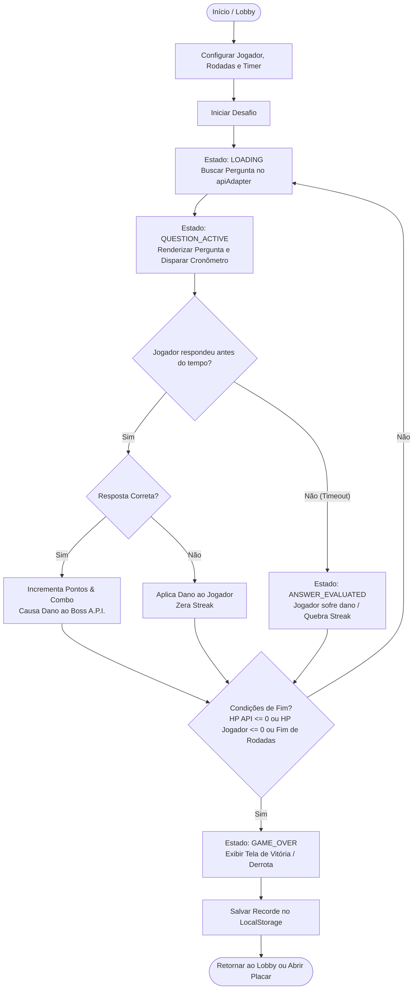

# 🎮 TriviaTech — Duelo de Conhecimento: Jogador vs A.P.I.

<div align="center">


<p align="center">
  <b>Um minigame web moderno e gamificado onde o jogador enfrenta um "Boss" de inteligência artificial em rodadas dinâmicas de perguntas e respostas.</b>
</p>

</div>

---

## 📌 Sumário

1. [Sobre o Projeto](#-sobre-o-projeto)
2. [Contexto Acadêmico](#-contexto-acadêmico)
3. [Mecânicas do Jogo](#-mecânicas-do-jogo)
4. [Arquitetura e Design Patterns](#-arquitetura-e-design-patterns)
5. [Tecnologias Utilizadas](#-tecnologias-utilizadas)
6. [Fluxo da Aplicação](#-fluxo-da-aplicação)
7. [Instalação e Execução Local](#-instalação-e-execução-local)
8. [Configuração de Variáveis de Ambiente](#-configuração-de-variáveis-de-ambiente)
9. [Estrutura de Pastas](#-estrutura-de-pastas)
10. [Roadmap de Expansão](#-roadmap-de-expansão)
11. [Autores e Agradecimentos](#-autores-e-agradecimentos)

---

## 💡 Sobre o Projeto

O **TriviaTech** é uma *Single Page Application* (SPA) de quiz com temática tecnológica/cyberpunk. O jogador é desafiado a combater a **A.P.I. (Autonomous Processing Intelligence)** em um duelo em tempo real.

O projeto foi desenvolvido com foco em:
- **Gamificação completa**: Barras de vida dinâmicas (HP), combos com multiplicadores de pontuação e cronômetro sob pressão.
- **Design System Responsivo**: Interface adaptável construída com **Bootstrap 5.3**, suporte nativo a temas **Dark e Light** e iconografia via **Bootstrap Icons**.
- **Consumo de APIs Externas**: Coleta em tempo real de informações geográficas e capitais mundiais via **REST Countries API**.
- **Código desacoplado**: Uso de padrões de projeto para permitir a expansão para múltiplas APIs de trivia no futuro.

---

## 🎓 Contexto Acadêmico

Projeto desenvolvido como parte dos requisitos práticos da disciplina:

- **Instituição**: Centro Universitário Braz Cubas (Brazcubas)
- **Curso**: Bacharelado em Sistemas de Informação
- **Disciplina**: Tópicos Avançados de Sistemas de Informação II (TASI II)
- **Docente / Orientadora**: Profa. Aline dos Santos

---

## 🕹️ Mecânicas do Jogo

O jogo combina mecânicas clássicas de *Trivia/Quiz* com elementos de combate estilo *RPG / Boss Fight*:

### 1. Sistema de Duelo (HP / Integridade)
- **Jogador**: Começa com 100 pontos de vida (HP). Respostas incorretas causam perda de vida.
- **A.P.I. (Boss)**: Inicia com barra de integridade em 100%. Cada acerto do jogador desfere dano direto ao núcleo da API.
- **Vitória ou Derrota**: O confronto encerra quando a vida da API chega a 0, quando o jogador é eliminado ou ao final do total de rodadas configuradas.

### 2. Multiplicadores e Combos (Streak)
- Acertos consecutivos ativam bônus de combo escalonados:
  - `1x`: Pontuação base (100 pts)
  - `1.25x`: 2 acertos seguidos
  - `1.5x`: 3 acertos seguidos
  - `2.0x`: 4 ou mais acertos consecutivos (Dano crítico na API)
- Errar uma questão zera a sequência de combos imediatamente.

### 3. Temporizador Sob Pressão
- Opções configuráveis no Lobby: **Sem tempo**, **15 segundos** ou **30 segundos** por rodada.
- O tempo restante bonifica a pontuação final caso a resposta seja rápida. Se o cronômetro zerar, a rodada é considerada falha e o jogador sofre dano.

### 4. Placar de Recordes (Ranking Local)
- Salva no `localStorage` do navegador as melhores pontuações, data da partida, taxa de acerto (%) e maior sequência de combos.
- Acesso rápido aos recordes através do menu lateral *Offcanvas* do Bootstrap.

---

## 📐 Arquitetura e Design Patterns

A arquitetura do projeto foi estruturada visando desacoplamento, legibilidade e manutenibilidade:

- **Service Adapter Pattern (`apiAdapter.js`)**:
  - Fornece uma camada intermediária que padroniza o contrato de perguntas (`StandardQuestion`). A interface gráfica e a *engine* do jogo não dependem dos detalhes de implementação da API REST Countries, permitindo plugar facilmente outros provedores de dados.
- **State Pattern / Finite State Machine (`gameState.js` & `gameEngine.js`)**:
  - Gerenciamento rigoroso do ciclo de vida do jogo:
    `LOBBY` ➔ `LOADING` ➔ `QUESTION_ACTIVE` ➔ `ANSWER_EVALUATED` ➔ `GAME_OVER`.
- **UI Manager (`uiManager.js`) & Theme Manager (`themeManager.js`)**:
  - Centraliza a manipulação do DOM e a reatividade visual (cards, toasts, modais, animações de shake e acerto).
  - Controle de tema (Dark/Light) com persistência automática no armazenamento local.

---

## 🛠️ Tecnologias Utilizadas

| Tecnologia | Finalidade |
| :--- | :--- |
| **JavaScript (ES6+)** | Lógica de jogo, controle de estado e consumo de dados |
| **Vite 8** | Servidor de desenvolvimento rápido e empacotador de assets |
| **Bootstrap 5.3** | Framework CSS responsivo com suporte nativo a temas (Dark/Light) |
| **Bootstrap Icons** | Biblioteca de ícones vetoriais modernos |
| **Axios** | Cliente HTTP baseado em Promises para consumo de APIs REST |
| **ESLint** | Padronização e garantia de qualidade de código estático |
| **LocalStorage API** | Persistência do ranking local de jogadores |

---

## 🔄 Fluxo da Aplicação

O diagrama abaixo ilustra o ciclo de vida de uma partida:



---

## 💻 Instalação e Execução Local

### Pré-requisitos
- **Node.js** (versão 18 ou superior)
- Gerenciador de pacotes **npm**

### Passo a Passo

1. **Clone o repositório:**
   ```bash
   git clone https://github.com/SEU_USUARIO/PJAC-TASI2-TriviaTech.git
   cd PJAC-TASI2-TriviaTech
   ```

2. **Instale as dependências:**
   ```bash
   npm install
   ```

3. **Configure as variáveis de ambiente:**
   Duplique o arquivo `.env.example` criando um arquivo chamado `.env`:
   ```bash
   cp .env.example .env
   ```
   *(No Windows PowerShell: `Copy-Item .env.example .env`)*

4. **Inicie o servidor de desenvolvimento:**
   ```bash
   npm run dev
   ```

5. **Acesse no navegador:**
   Abra o endereço exibido no terminal (geralmente `http://localhost:5173`).

---

## 🔑 Configuração de Variáveis de Ambiente

O projeto utiliza a API **REST Countries** para geração dinâmica das perguntas sobre capitais e países. Atualmente, a API requer uma chave ativa de identificação:

1. Acesse o portal da [REST Countries API](https://restcountries.com/) ou gere sua chave gratuita.
2. Abra o arquivo `.env` na raiz do projeto e insira sua chave:

```env
## Chave de API do RestCountries
VITE_API_KEY_RESTCOUNTRIES=rc_live_SUACHAVEAQUI
```

---

## 📂 Estrutura de Pastas

```text
PJAC-TASI2-TriviaTech/
├── directives/               # Especificações e planejamento do projeto
│   └── PLAN.md
├── src/
│   ├── game/                 # Regras de negócio e motor do jogo
│   │   ├── gameEngine.js     # Regras de cálculo, dano, streak e fluxo
│   │   └── gameState.js      # Gerenciamento de estado da partida
│   ├── services/             # Integração com APIs externas
│   │   ├── apiAdapter.js     # Adaptador genérico (Adapter Pattern)
│   │   └── restCountriesService.js # Serviço do REST Countries
│   ├── storage/              # Persistência
│   │   └── rankingStorage.js # Gerenciamento do ranking no localStorage
│   └── ui/                   # Camada de apresentação e DOM
│       ├── themeManager.js   # Controle Dark/Light mode
│       └── uiManager.js      # Renderização de HUD, cards e modais
├── .env.example              # Exemplo de configuração de variáveis
├── design.md                 # Especificação técnica do Design System
├── index.html                # Ponto de entrada HTML e templates
├── package.json              # Metadados e dependências do projeto
├── script.js                 # Inicialização da aplicação (Entry Point)
├── style.css                 # Estilos customizados complementares ao Bootstrap
└── vite.config.js            # Configurações do Vite (quando aplicável)
```

---

## 🚀 Roadmap de Expansão

Melhorias e evoluções planejadas para versões futuras:

- [ ] **Integração com OpenTriviaDB**: Adicionar suporte a perguntas de tecnologia, história, ciências e cultura pop.
- [ ] **Seletor de Bosses**: Possibilidade de escolher contra qual API lutar no Lobby (ex.: *A.P.I. Geocore*, *A.P.I. DevBot*, *A.P.I. Science*).
- [ ] **Efeitos Sonoros Retrô / 8-bit**: Efeitos de ataque, dano sofrido, combo e trilha sonora imersiva.
- [ ] **Modo Multijogador Local (Pass 'n Play)**: Dois jogadores competindo no mesmo dispositivo.
- [ ] **Deploy em Nuvem**: Publicação contínua via Vercel ou Netlify.

---

## 👥 Autores e Agradecimentos

Projeto desenvolvido pelos acadêmicos:

- **Matheus Estrela**
- **Alexandre da Silva**

**Orientação e Docência:**
- **Profa. Aline dos Santos** — *Tópicos Avançados de Sistemas de Informação II*

---

<div align="center">
  <sub>Desenvolvido com ☕ e código para o Centro Universitário Braz Cubas.</sub>
</div>
